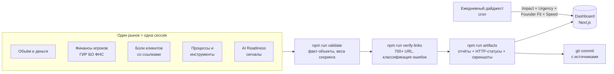

# Market Intelligence Platform — кейс

    

> AI-driven платформа, которая каждую неделю ищет в открытых данных РФ бизнес-возможность, способную дойти до первых денег быстрее, чем за 30 дней — и умеет отличить это от рынка, который просто красиво выглядит на бумаге.

---

## TL;DR

За 5 дней с нуля спроектирована и запущена платформа полного цикла **событие → возможность → эксперимент → лиды → ROI**: 5 параллельных research-агентов Claude Code на рынок, двухосевой скоринг (Launch Score / Scale Score), инфраструктура доверия к данным (факт-объекты с источником и датой, автовалидатор, автопроверка 700+ ссылок) и дашборд на Next.js, который агрегирует всё это в единый рейтинг возможностей. На момент кейса: **14 рынков · 203 компании · 263 боли · 83 возможности · 9 кросс-рыночных паттернов · 13 решений в Decision Log · 27 коммитов** за 6 недель работы.

---

## 1. Задача

Классический подход «нашёл идею → сделал продукт → узнал, что рынка нет» переворачивается. Вопрос не «что построить», а:

1. Где сильнее всего болит?
2. Кто уже платит за решение?
3. Что до сих пор делают вручную?
4. Что из этого можно заменить AI?
5. Как быстро можно получить первых клиентов?

Платформа — не энциклопедия рынков и не аналитический отчёт для инвестора. Единственный критерий качества результата — **помогает ли он принять решение и получить первые деньги**, а не количество собранных полей. Правило проекта сформулировано прямо в его конституции: «данные важнее кода» — если выбор между красивым графиком и ещё одним исследованным рынком, выбор всегда в пользу рынка.

## 2. Идея и роль AI

**Роль:** основатель и продакт — архитектура, методология и приёмка результата. **Реализация** — оркестрация агентов Claude Code: пять параллельных исследовательских сессий на рынок, ежедневный автономный дайджест новостей по cron, скрипты контроля качества.

Это не «AI написал код», это управляемый исследовательский конвейер: каждая итерация начинается с промпта-регламента, заканчивается коммитом с источниками, и не считается завершённой, пока не прошла через автоматическую проверку.

## 3. Как это устроено

### 3.1 Архитектурное решение: без базы данных

Пока рынков меньше сотни — **JSON-файлы, версионируемые в git, вместо СУБД**. Осознанный отказ от «промышленной архитектуры на десятки миллионов компаний» (такое предлагал другой AI на старте) в пользу минимализма: статический дашборд читает `data/` на сервере, git хранит всю историю правок как есть, каждая итерация исследования = отдельный коммит.

```
data/
  founder.json            # профиль основателя — против него считается Founder Fit
  schema/                 # JSON Schema — документация структур
  markets/<slug>/
    market.json           # объём (вилкой из 2+ источников), сегменты, buying power
    companies/*.json      # 1 компания = 1 файл, финансы из ГИР БО ФНС
    pains.json            # база болей рынка со ссылками на первоисточники
    workflows.json        # карта процессов отрасли
    opportunities.json    # идеи с двухосевым скорингом
  patterns.json           # кросс-рыночные архетипы (Confirmed/Experimental/Contradicted)
  decisions.json          # Decision Log — почему идея отклонена и когда вернуться
  experiments.json        # Experiment Database — реальные расходы, лиды, продажи, CAC
  graveyard.json          # умершие/поглощённые продукты рынка — тоже факт
research/<slug>.md        # полный отчёт с цитатами и ссылками на источники
scripts/                  # validate.mjs · verify-links.mjs · make-artifacts.mjs
dashboard/                # Next.js 16 (App Router, Server Components, Tailwind v4)
```

### 3.2 Исследовательский конвейер



### 3.3 Обратная связь по данным

Цепочка **событие → возможность → эксперимент → лиды → продажи → ROI** обязана прослеживаться по данным, а не оставаться лозунгом: событийная возможность хранит URL источника события в `why_now`, каждый эксперимент ссылается на `opportunity_id`, а исход (ROI, вывод) пишется обратно в `experiments.json`. Через несколько месяцев это должно ответить на вопрос, какие ТИПЫ событий чаще приводят к реальным деньгам — собственная статистика вместо чужой аналитики.

## 4. Этапы, которые мы прошли

| Дата | Веха |
|---|---|
| **13 июля** | Старт с нуля. Отказ от СУБД в пользу JSON-в-git. Сформулированы правила данных и двухосевой скоринг. За день — 2 рынка (HR-tech, influencer-маркетинг), инфраструктура доверия (артефакты, verify-links), заморозка архитектуры до 10–15 рынков. |
| **14 июля** | Рынок №3 (performance-маркетинг). Запущены Event Radar и ежедневный дайджест по cron. Первый кросс-рыночный вывод: деньги — в недоверии между сторонами сделки. |
| **15–17 июля** | Первый автономный дайджест поймал реальное окно (реклама в MAX ×11 за полугодие). Рынки №4 (топливо/АЗС — событийный полигон) и №5 (автогрузоперевозки). Верификация чужой AI-сессии вскрыла 3 бага инструментов (UTC-датировка, классификация 5xx, порог баннера) — все исправлены. |
| **18–21 июля** | Decision Log: первое бинарное решение с дедлайном (сжатие окна по топливу). Рынок №6 (недвижимость), рынок №7 (автосервисы). Введены Cross-Market Insights и «кладбище продуктов» — умерший продукт равноценен факту о живом. |
| **25 июля** | Сдвиг методологии: вместо каталога рынков — **система обнаружения архетипов** (сила паттерна, статус Confirmed/Experimental/Contradicted, Data Flywheel, Economic Trigger). |
| **27 июля – 9 августа** | Рынки №8–13 (юруслуги, салоны красоты, общепит, стройка/ремонт, фитнес, EdTech) и рынок туризма — целенаправленная проверка ранее найденных архетипов на новых нишах, а не сбор энциклопедии. Плановая ревизия системы после рынка №10. |
| **24 августа** | Продолжение автономного дайджеста — платформа работает в режиме постоянного мониторинга поверх накопленной базы. |

**Итог на сегодня:** 14/15 рынков первой фазы · 203 компании · 263 боли · 83 возможности · 9 кросс-рыночных паттернов · 13 решений в Decision Log · 27 коммитов.

## 5. Методология скоринга

Каждая возможность оценивается по двум независимым осям, а не по одному «рейтингу»:

| Ось | Что отвечает | Компоненты и веса |
|---|---|---|
| **Launch Score (0–100)** | Можно ли заработать первые деньги за 30 дней | острота боли (0.25) · платящий спрос уже сейчас (0.2) · достижимость ЛПР (0.2) · реальность MVP за 7 дней (0.2) · founder fit (0.15) |
| **Scale Score (0–100)** | Потолок ниши, если MVP выстрелит | размер рынка (0.3) · слабость конкурентов (0.3) · moat (0.2) · расширяемость (0.2) |

Рынок объёмом 1 млрд ₽ с циклом сделки 18 месяцев проигрывает рынку 100 млн ₽ с продажей завтра — сортировка везде по Launch Score. Отдельно, как флаг, а не как слагаемое весов — **Data Flywheel**: накапливает ли продукт преимущество с каждым клиентом (data / workflow / community / marketplace / model / content), проверяется чек-листом из 4 вопросов, а не подгоняется под красивую формулировку.

## 6. Инфраструктура доверия к данным

Главный технический актив платформы — не дашборд, а система, которая не даёт AI придумывать цифры:

- **Ни одной цифры без источника.** Каждое число — факт-объект `{ value, unit, period, source_url, retrieved_at, confidence, method }`. Нарушения ловит `scripts/validate.mjs`.
- **Закрытые метрики не выдумываются** (LTV, CAC, churn частных компаний) — «нет в открытых источниках» вместо оценки на глаз.
- **Объём рынка — только вилкой** из 2+ независимых источников; перепечатки одного отчёта источником не считаются.
- **История, не перезапись**: пересмотренное значение помечается `superseded: true`, старое не удаляется — git и так хранит каждую итерацию отдельным коммитом.
- **Доказательства, а не слова**: `npm run artifacts` создаёт `artifacts/<дата>/` с выводом валидатора, отчётом проверки ссылок и HTTP-статусами. «Я проверил» без этой папки не считается проверкой.
- Автопроверка живости **769 URL** с классификацией отказа (антибот / транзиентная ошибка / битая ссылка).

## 7. Практический выход

- **Event Radar** зафиксировал открытие и сжатие рыночного окна в топливный кризис 2026 — с датой пересмотра в Decision Log.
- Выводы платформы **предотвратили запуск заведомо проигрышной B2C-фичи** в действующем продукте (крупные игроки закрыли нишу за месяц) и указали на событийную возможность с жёстким дедлайном (переход отрасли на ЭПД к 01.09.2026).
- Подтверждены **9 кросс-рыночных паттернов** (независимая AI-проверка, продуктизированная услуга за фикс, комплаенс под ключ с дедлайном, клиентский конвейер для локального СМБ), а также закреплены анти-паттерны — например, двусторонние офлайн-маркетплейсы не строятся в этой форме на основе 4 подряд решений.

## 8. Технологический стек

| Слой | Технологии |
|---|---|
| Данные | JSON-файлы в git, JSON Schema как документация структур, без БД |
| Дашборд | Next.js 16 (App Router, Server Components, Turbopack), React 19, TypeScript, Tailwind CSS v4 |
| Инструменты качества | Node.js zero-dependency скрипты: `validate.mjs`, `verify-links.mjs`, `make-artifacts.mjs`, `snapshot-scores.mjs`, headless Chrome для скриншотов |
| AI-оркестрация | Claude Code: параллельные background-агенты на исследование, scheduled tasks (cron-дайджест), CLAUDE.md как регламент-«конституция» |
| Источники данных | bo.nalog.ru (ГИР БО ФНС), api.hh.ru, Smart Ranking, Data Insight, TAdviser, АКАР, ЕРИР |

## 9. Гид по запуску и деплою

### 9.1 Локальный запуск

```bash
git clone <URL-репозитория> market-intel
cd market-intel
npm run validate        # проверка целостности data/ (факт-объекты, веса скоринга)

cd dashboard
npm install
npm run dev             # http://localhost:3000
```

Дашборд — серверный компонент Next.js, он читает `data/` **на файловой системе** относительно `dashboard/` (`path.resolve(process.cwd(), "..", "data")`), поэтому папки `dashboard/` и `data/` всегда должны разворачиваться вместе, из одного чекаута репозитория.

### 9.2 Проверка данных перед деплоем

```bash
npm run validate        # из корня репозитория — фейлит на нарушении правил фактов
npm run verify-links    # проверка живости источников (антибот / битая / ок)
npm run artifacts       # артефакты итерации: артифакты/<дата>/ со скриншотами и статусами
```

Деплоить имеет смысл только после зелёного `validate` — это тот же гейт, что стоит перед каждым коммитом в data/.

### 9.3 Деплой дашборда (Vercel)

1. Импортировать репозиторий в Vercel → **Root Directory: `dashboard`**.
2. Build command оставить стандартным (`next build`), Node.js 20+.
3. **Важный нюанс архитектуры**: дашборд читает JSON через `fs.readFileSync` по динамическому пути `../data/...`, а не через `import`, поэтому статический трейсинг файлов Next.js/Vercel может не подхватить `data/` автоматически при сборке serverless-функций. Перед первым продакшн-деплоем стоит явно прописать эту директорию в `outputFileTracingIncludes` в `dashboard/next.config.ts`, либо проверить билд-лог Vercel на предмет отсутствующих файлов в бандле.
4. Так как источник истины — git, а не рантайм-БД, у дашборда нет env-переменных и секретов: любой чекаут ветки `main` уже содержит полный слепок данных.
5. После деплоя — smoke-check: страницы `/`, `/rating`, `/markets/<slug>`, `/pains`, `/experiments` открываются и показывают актуальные числа из `data/`.

### 9.4 Обновление продакшна после нового рынка

Рабочий цикл одинаков локально и в проде: `validate → verify-links → artifacts → commit → push`. Пуш в `main` — единственный триггер редеплоя; глобальный рейтинг (`/rating`) агрегирует все `opportunities.json` автоматически, без ручных правок дашборда.

## 10. Что дальше

Дорожная карта не «рынок → идея → сервис», а последовательность: **15 рынков → ~100 возможностей в глобальном рейтинге → ТОП-10 → интервью с клиентами → лендинг → реклама → первые продажи → и только потом разработка продукта.** Архитектура заморожена до конца первой фазы: новая функциональность добавляется, только если потребность повторилась минимум в трёх независимых исследованиях — иначе идея уходит в `BACKLOG.md`, а не в код.

---

*Кейс подготовлен на основе фактического состояния репозитория (git-история 13 июля — 24 августа 2026, срез данных на 07.09.2026).*
